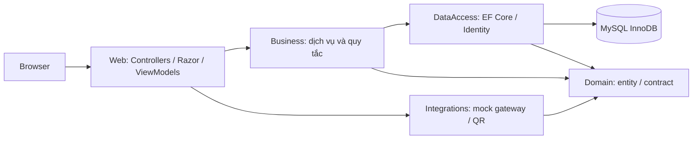
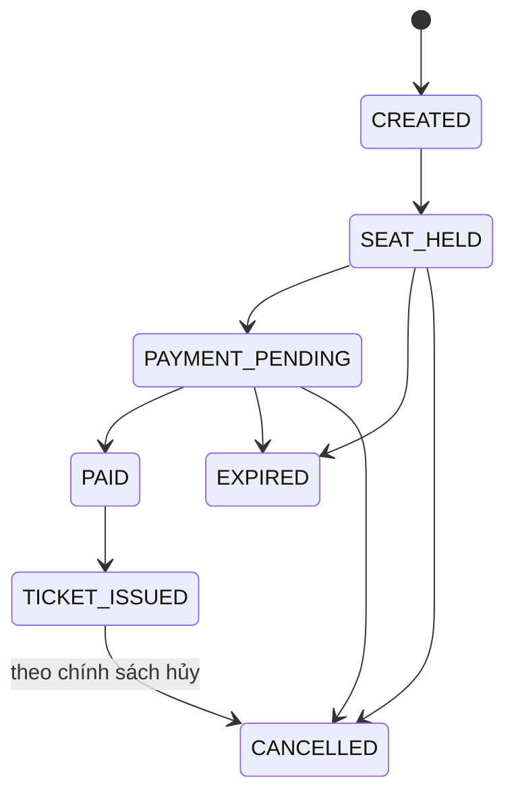
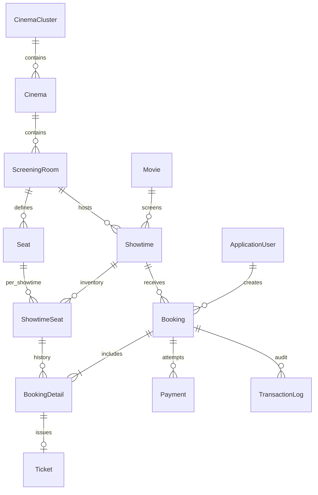
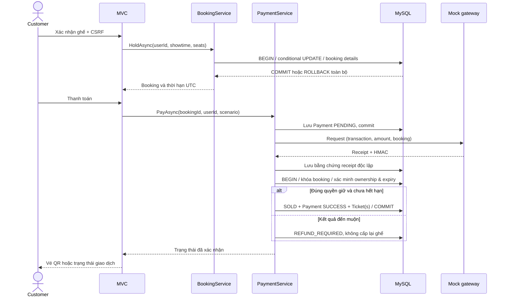

# Thiết kế VEGA CINEMAS

## Phạm vi và giả định
- Ứng dụng MVC tập trung. Web ở project gốc `VegaCinema.csproj` để giữ cấu hình Visual Studio sẵn có; các tầng nằm trong `src/`.
- .NET 8 LTS tương thích SDK và Visual Studio hiện có. Theo Microsoft, hỗ trợ đến 10/11/2026: https://dotnet.microsoft.com/en-us/platform/support/policy. Cần nâng cấp LTS trước khi vận hành sau mốc này.
- MySQL 8.4/InnoDB, EF Core 8/Pomelo 8; UTC trong database, UTC+7 khi hiển thị và nhập lịch.
- Chưa có tệp UML gốc. Sơ đồ dưới đây được suy ra từ yêu cầu, chưa thể đối chiếu với sơ đồ đồ án bên ngoài.
- Giữ ghế 10 phút (cấu hình 5–10); tối đa 8 ghế/đơn. Đệm dọn phòng 15 phút; không đặt suất đã bắt đầu.
- Khách được hủy trước giờ chiếu ít nhất 2 giờ, khi chưa dùng vé. Thanh toán mô phỏng ghi nhận hoàn tiền trong sổ giao dịch, không thực hiện chuyển tiền thực.
- Staff, checker và manager bị giới hạn cụm rạp trên tài khoản; admin có toàn quyền. Tài khoản tự đăng ký luôn là CUSTOMER.
- Poster là SVG minh họa gốc, tên phim và dữ liệu đều là demo, không tuyên bố lịch phát hành thực tế.

## Phụ thuộc

## Nhất quán dữ liệu
Giữ ghế thực hiện trong transaction ngắn: tạo booking, conditional UPDATE từng ShowtimeSeat theo thứ tự khóa tăng dần, yêu cầu số dòng cập nhật bằng số ghế. Một thất bại rollback cả đơn. Trạng thái ghế không nằm trên Seat vật lý.

Thanh toán tạo Payment PENDING và commit trước khi gọi gateway. Kết quả có HMAC, backend kiểm tra chữ ký, transaction, amount và booking. Khóa dòng booking bằng SELECT FOR UPDATE bảo vệ callback, hết hạn và hủy. Phát hành vé, SOLD và kết quả payment cùng một transaction. Callback lặp trả lại kết quả đã lưu. Callback muộn lưu REFUND_REQUIRED, không giành lại ghế.

BackgroundService giải phóng đơn hết hạn, đồng thời dịch vụ kiểm tra thời hạn ở mọi thao tác quan trọng. Vé chỉ sử dụng một lần bằng conditional UPDATE VALID → USED. Suất chiếu khóa dòng phòng trước khi kiểm tra chồng lấn, bao gồm 15 phút dọn phòng.

## Máy trạng thái

## Màn hình
Trang chủ; danh sách và chi tiết phim; lịch chiếu; hệ thống rạp; chọn ghế; checkout; vé QR/in; đăng ký/đăng nhập/hồ sơ/đổi mật khẩu; lịch sử đơn; tra cứu đơn và kiểm vé; admin dashboard, phim, cụm rạp, rạp, phòng/ghế, suất chiếu, người dùng/vai trò, booking/payment/ticket, nhật ký và báo cáo có phạm vi.

Các mục tiêu P95, uptime và 5.000–10.000 booking/ngày cần benchmark và hạ tầng thực tế. Không coi kiểm thử chức năng là bằng chứng đạt các mục tiêu này.

## Quan hệ dữ liệu

## Tương tác thanh toán

